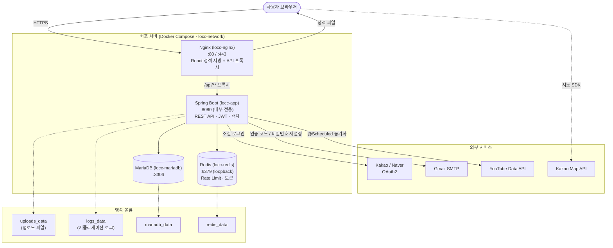

# LOCC — 그리스도사랑교회 웹사이트

> **Love Of Christ Church** 공식 홈페이지 풀스택 프로젝트

---

## 기술 스택

### Backend
| 분류 | 기술 |
|------|------|
| Framework | Spring Boot 3.x |
| Language | Java 17 |
| Security | Spring Security 6 · JWT (HttpOnly 쿠키) |
| ORM | Spring Data JPA · Hibernate |
| Database | MariaDB |
| Cache / Rate Limit | Redis |
| Build | Gradle |
| Auth | 자체 로그인 + OAuth2 (Kakao · Naver) |
| File | 로컬 파일시스템 (도메인별 디렉토리 분리) |
| Mail | Gmail SMTP (이메일 인증 · 비밀번호 재설정) |

### Frontend
| 분류 | 기술 |
|------|------|
| Framework | React 19 + Vite |
| Styling | Tailwind CSS v4 |
| State | Zustand |
| Server State | TanStack Query v5 |
| HTTP | Axios (withCredentials) |
| Editor | Quill (공지·설교 리치 텍스트) |
| Toast | Sonner |

### Infra
| 분류 | 기술 |
|------|------|
| Container | Docker · Docker Compose |
| Web Server | Nginx (정적 서빙 + API 리버스 프록시) |
| CI/CD | GitHub Actions (테스트 · 빌드 자동 검증) |

---

## 시스템 아키텍처

Nginx를 단일 진입점으로 두고, 백엔드·DB·캐시는 외부에 노출하지 않는 **단일 도메인 / 내부 네트워크** 구조입니다.
React 정적 파일은 Nginx가 직접 서빙하고, `/api/**` 요청만 Spring Boot로 리버스 프록시합니다.



### 요청 흐름 요약
1. 사용자의 모든 트래픽은 **Nginx(80/443)** 로만 진입합니다. (`app`·`db`·`redis`는 외부 미노출)
2. 정적 React 자산은 Nginx가 직접 응답하고, `/api/**` 만 내부의 **Spring Boot(8080)** 로 프록시됩니다.
3. Spring Boot는 **MariaDB**(영속 데이터)·**Redis**(Rate Limit·토큰)와 통신하고, 필요 시 **외부 API**(OAuth2·메일·YouTube)를 호출합니다.
4. 업로드 파일·로그·DB·Redis 데이터는 **Docker 볼륨**으로 분리되어 재배포 시에도 보존됩니다.

---

## 주요 기능

### 사용자
- **인증** — 이메일 회원가입(인증코드) · 로그인 · 비밀번호 재설정 · 카카오/네이버 소셜 로그인
- **예배** — 주일오전/오후·수요·금요·훈련메시지 설교 목록·상세, YouTube 연동
- **공지사항** — 목록·상세·첨부파일 다운로드, 리치 텍스트 (Quill)
- **주보** — PDF 주보 목록·뷰어 (로그인 필수)
- **부서** — 태영아·유치·아동·청소년·청년·다민족 각 부서 소개·갤러리
- **훈련신청** — 훈련 과정 목록·상세·신청·내 신청 현황
- **시설·차량 신청** — 신청서 작성·조회·취소
- **마이페이지** — 개인정보 수정·소셜 계정 연결

### 관리자
- 공지사항 · 설교 · 갤러리 · 팝업 · 주보 CRUD
- 회원 승인·반려·권한 관리 (ADMIN / OPERATOR)
- 훈련신청 현황 관리 · Excel 다운로드
- 시설·차량 신청 관리
- YouTube 재생목록 설정
- 도움 요청 관리

---

## 프로젝트 구조

```
locc/
├── src/main/java/com/example/locc/
│   ├── domain/
│   │   ├── user/          # 사용자 (인증 포함)
│   │   ├── notice/        # 공지사항
│   │   ├── sermon/        # 설교
│   │   ├── bulletin/      # 주보
│   │   ├── gallery/       # 갤러리
│   │   ├── department/    # 부서
│   │   ├── file/          # 파일 업로드/서빙
│   │   ├── training/      # 훈련신청
│   │   ├── application/   # 시설·차량 신청
│   │   ├── popup/         # 팝업
│   │   ├── staff/         # 스태프
│   │   └── visitor/       # 방문자 카운트
│   ├── config/            # Security · CORS · File · Redis 설정
│   ├── security/          # JWT 필터 · OAuth2 핸들러
│   ├── exception/         # 전역 예외 처리
│   └── common/            # ApiResponse · ErrorCode · PageResponse
│
├── src/main/resources/
│   ├── application.yml          # 공통 설정 (환경변수 기반)
│   ├── application-local.yml    # 로컬 전용
│   └── application-prod.yml     # 운영 전용
│
└── frontend/
    ├── src/
    │   ├── api/           # Axios API 호출 모듈
    │   ├── components/    # 공통 UI 컴포넌트
    │   ├── hooks/         # 커스텀 훅 (Quill 에디터 등)
    │   ├── pages/         # 라우트별 페이지
    │   ├── stores/        # Zustand 전역 상태
    │   └── utils/         # 유틸 함수
    ├── Dockerfile          # 멀티 스테이지 빌드 (Node → Nginx)
    └── nginx.conf          # SPA 라우팅 + API 프록시
```

---

## 인증 구조

```
로그인 요청
  → 서버: accessToken + refreshToken → HttpOnly 쿠키 설정
  → 브라우저: 쿠키 자동 전송 (withCredentials: true)
  → 만료 시: /api/auth/refresh 자동 호출 (Axios 인터셉터)
  → 최종 실패: 로그인 페이지 리다이렉트
```

- `accessToken`: 5시간
- `refreshToken`: 7일 (Rotation 방식 — 갱신 시 새 토큰 발급)
- `SameSite=Lax`, `HttpOnly` — XSS/CSRF 방어

---

## 로컬 개발 환경 세팅

### 1. 사전 요구사항

- Java 17
- Node.js 20+
- MariaDB
- Redis

### 2. 환경변수 설정

```bash
cp .env.example .env
# .env 파일을 열어 DB, JWT, API 키 등 입력
```

### 3. 백엔드 실행

```bash
./gradlew bootRun
# 기본 포트: 8080
```

### 4. 프론트엔드 실행

```bash
cd frontend
npm install
npm run dev
# 기본 포트: 3000 (Vite 개발서버, /api/** → 8080 프록시)
```

---

## Docker 배포

### 필수 환경변수 (.env)

```bash
# 데이터베이스
DB_NAME=locc
DB_USERNAME=locc_user
DB_PASSWORD=your-password
DB_ROOT_PASSWORD=your-root-password

# JWT (openssl rand -base64 64 으로 생성)
JWT_SECRET=your-secret

# Redis
REDIS_PASSWORD=your-redis-password

# 이메일
MAIL_USERNAME=your-email@gmail.com
MAIL_PASSWORD=your-app-password

# OAuth2
KAKAO_CLIENT_ID=your-kakao-id
NAVER_CLIENT_ID=your-naver-id
NAVER_CLIENT_SECRET=your-naver-secret

# API 키
KAKAO_MAP_API_KEY=your-kakao-map-key
YOUTUBE_API_KEY=your-youtube-key

# 서비스 도메인 (CORS, OAuth2 콜백에 사용)
APP_DOMAIN=https://example.com
```

### 실행

```bash
docker compose up -d --build
```

| 서비스 | 컨테이너 | 역할 |
|--------|----------|------|
| `nginx` | locc-nginx | React 서빙 + API 리버스 프록시 (포트 80) |
| `app` | locc-app | Spring Boot API 서버 (내부 포트 8080) |
| `db` | locc-mariadb | MariaDB 11.2 |
| `redis` | locc-redis | Redis 7.2 |

### 파일 영속성 (Docker 볼륨)

| 볼륨 | 내용 |
|------|------|
| `mariadb_data` | 데이터베이스 |
| `redis_data` | Redis 데이터 |
| `uploads_data` | 업로드 파일 (`/app/uploads`) |
| `logs_data` | 애플리케이션 로그 (`/app/logs`) |

---

## API 구조

```
/api/auth/**          인증 (로그인·회원가입·토큰 갱신)
/api/notices/**       공지사항
/api/sermons/**       설교
/api/bulletin/**      주보 (인증 필요)
/api/departments/**   부서·갤러리
/api/trainings/**     훈련 콘텐츠
/api/applications/**  훈련신청 (인증 필요)
/api/facility-applications/**  시설·차량 신청 (인증 필요)
/api/files/**         파일 업로드·스트리밍·다운로드
/api/popups/**        팝업
/api/staff/**         스태프
/api/mypage/**        마이페이지 (인증 필요)
/api/admin/**         관리자 전용 (ADMIN 권한)
```

---

## 환경별 설정

| 항목 | local | prod |
|------|-------|------|
| `spring.profiles.active` | `local` | `prod` |
| `jpa.ddl-auto` | `update` | `validate` |
| `cookie-secure` | `false` | `true` |
| Swagger UI | 활성화 (ADMIN 전용) | 비활성화 |
| 에러 메시지 노출 | `always` | `never` |
| 로그 레벨 | `DEBUG` | `INFO / WARN` |
